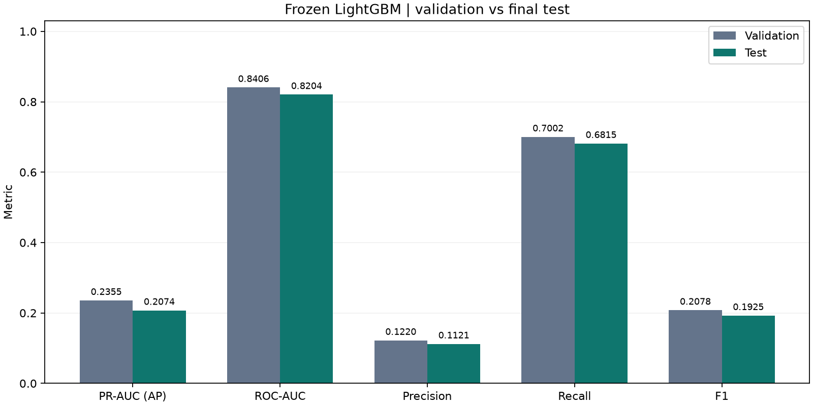
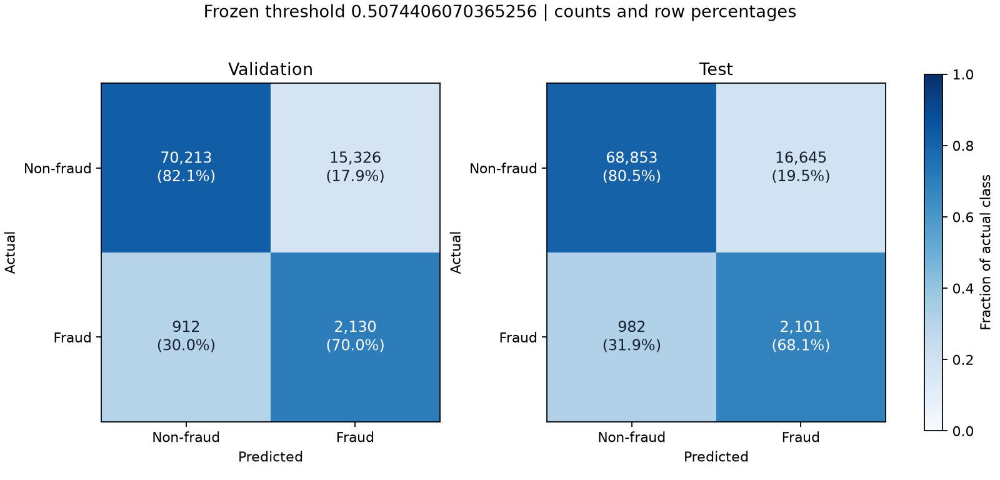

# Final holdout evaluation

One test scoring pass, completed 2026-11-24T19:34:39.052901+00:00. Model run `20261124T144826624784Z`. Frozen `max_precision_at_recall` threshold: **0.5074406070365256**; predict fraud when score >= threshold.

| Split | Rows | Fraud rows | PR-AUC (AP) | ROC-AUC | Precision | Recall | F1 |
| --- | ---: | ---: | ---: | ---: | ---: | ---: | ---: |
| validation | 88,581 | 3,042 | 0.235530 | 0.840563 | 0.122021 | 0.700197 | 0.207825 |
| test | 88,581 | 3,083 | 0.207379 | 0.820441 | 0.112077 | 0.681479 | 0.192496 |

Confusion matrices `[[TN, FP], [FN, TP]]` (actual rows, predicted columns):

- validation: `[[70213, 15326], [912, 2130]]`.
- test: `[[68853, 16645], [982, 2101]]`.

Test minus validation: pr_auc -0.028151, roc_auc -0.020122, precision -0.009944, recall -0.018718, f1 -0.015329.

The validation recall floor was 70%; final test recall is 68.15%. It is reported as observed, without adjusting the threshold.

## Integrity and scope

- Saved model, training metrics, split audit and threshold audit fingerprints checked before test loading. Existing training/preprocessing source is unchanged. The exact JSON threshold was fixed before scoring.
- Only test-window features/labels and matching identity rows were materialized. SQL scanned other IDs/times solely to confirm no test-ID overlap; no train/validation feature or label DataFrame was loaded.
- Test IDs unique/non-null; expected count, binary-label total, time bounds and order verified. Frozen train/validation/test time ranges are strictly separated. Join preserves every test row, label and time. These checks do not replace an unavailable original per-row raw-data hash manifest.
- One predict_proba call; no retraining, fitting, calibration, threshold sweep or test-based model selection. Saved validation metrics are reused, not recomputed. No other model (including no-skill) was evaluated.
- PR-AUC is average precision; scores are unchanged and uncalibrated. Validation was used for model/threshold selection, whereas the final test result was not used for tuning. The holdout is now consumed: do not retune against it.
- Only aggregate metrics/charts exported; no transaction rows, IDs or individual predictions. Model artifacts, training behavior, README and pytest files remain unchanged.
- Re-running the command renders these cached aggregates without loading or predicting test again. An interrupted scoring pass is blocked rather than automatically retried.

[Aggregate metrics/provenance](holdout_evaluation.json) | [Comparison CSV](holdout_comparison.csv)
