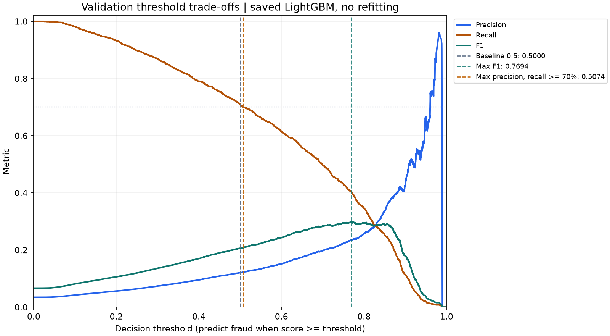
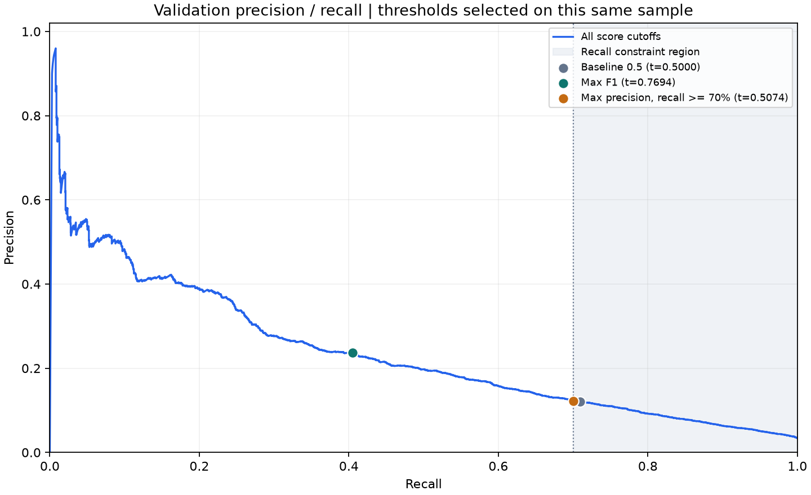
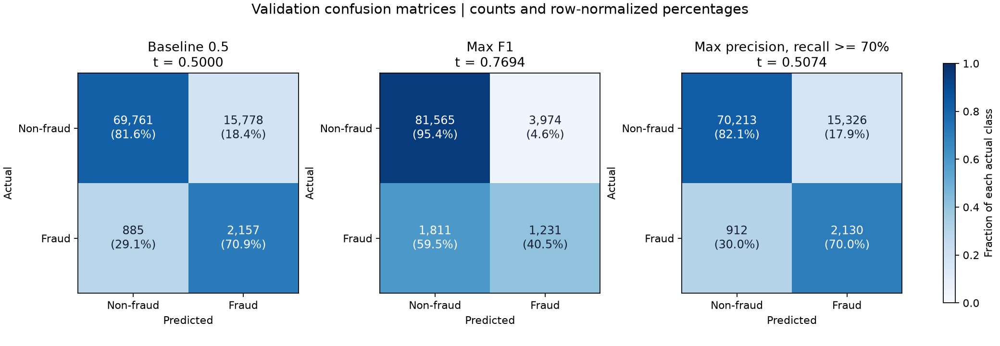

# Validation-only LightGBM threshold optimization

Saved model run `20261124T144826624784Z`. 88,581 validation transactions; 3,042 fraud labels. No retraining, test evaluation, or training-default changes.

| Policy | Threshold | Precision | Recall | F1 | TN | FP | FN | TP | Flagged % |
| --- | ---: | ---: | ---: | ---: | ---: | ---: | ---: | ---: | ---: |
| baseline_0_5 | 0.5000000000 | 0.120268 | 0.709073 | 0.205654 | 69,761 | 15,778 | 885 | 2,157 | 20.247 |
| max_f1 | 0.7694407948 | 0.236503 | 0.404668 | 0.298533 | 81,565 | 3,974 | 1,811 | 1,231 | 5.876 |
| max_precision_at_recall | 0.5074406070 | 0.122021 | 0.700197 | 0.207825 | 70,213 | 15,326 | 912 | 2,130 | 19.706 |

- Max-F1 change versus 0.5: F1 +0.092879, precision +0.116236, recall -0.304405.
- Max-precision with recall >= 0.70: precision change +0.001753, recall 0.700197 (2,130/3,042 fraud transactions detected).
- No operating point is applied automatically. Choose based on review capacity and error costs; max F1 and recall-constrained precision are different objectives.

## Charts

## Method and integrity

- Evaluated 57,699 exact candidate thresholds: every distinct validation score plus 0, 0.5, 1 and one representable value above the maximum score (predict-none). The last candidate can exceed 1 by one floating-point step. No coarse grid, interpolation or rounded-threshold selection.
- Predictions use `score >= threshold`. Equal scores enter/leave together. No-alert precision is defined as zero. Confusion matrices are `[[TN, FP], [FN, TP]]`, with actual rows and predicted columns.
- Optimize F1 without a recall constraint, and precision subject to recall >= 0.70. Ties prefer higher recall, then higher precision for max F1, then higher threshold. The recall floor is not relaxed.
- Existing chronological split and loader reused unchanged. The loader returns train/validation after filtering test rows from shared CSV scans; train is discarded and only validation is scored. No test DataFrame is materialized.
- Saved model checksum and split-audit fingerprint verified; validation metrics at 0.5 reproduce the saved training run. Prediction leaves the preprocessor and model file unchanged. No fit or calibration calls.
- Score ranking is unchanged: validation AP=0.235530, ROC-AUC=0.840563. Only the decision threshold changes; outputs remain uncalibrated scores.
- These thresholds are selected and measured on the same validation sample, which was also used for model selection/early stopping. Improvements are development estimates, not unbiased test performance or a guarantee of future recall. The test holdout remains reserved.
- Only aggregate metrics, thresholds and charts are exported, never IDs, features or per-transaction predictions. Full-precision thresholds are retained in JSON/CSV; displayed values are rounded and must not be used for exact replay.

[All threshold metrics](threshold_metrics.csv) | [Operating points](threshold_comparison.csv) | [Exact thresholds and provenance](threshold_optimization.json)
